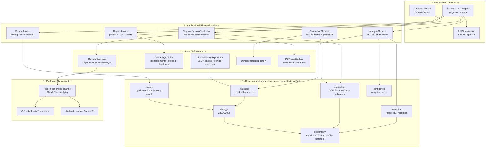
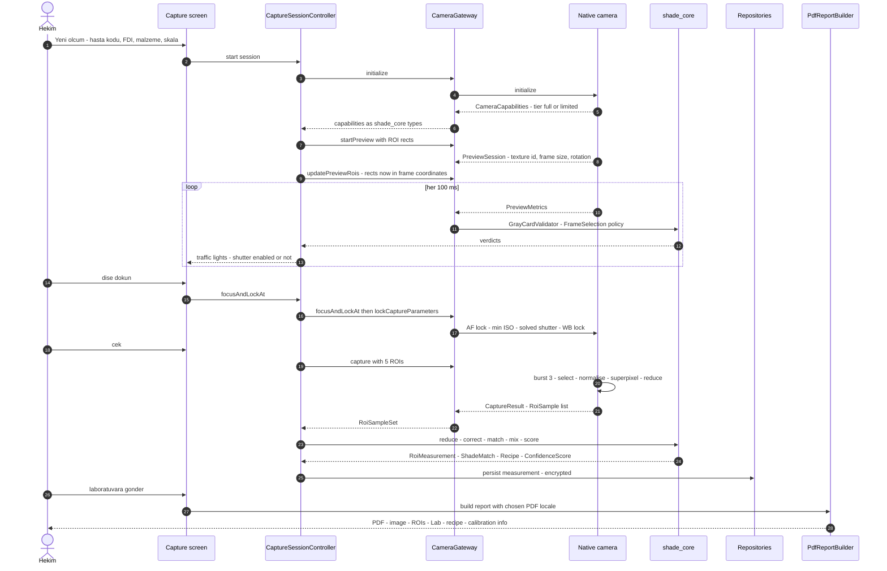

# Nüans / Nuans — Aşama 1: Mimari

Durum: taslak (Aşama 1 çıktısı)
Kapsam: katman mimarisi, modül sorumlulukları, klasör yapısı, kameradan rapora veri akışı,
Pigeon arayüz tanımı.
İlgili kararlar: [ADR-0001](../adr/0001-color-math-boundary.md)

Bu belge mimarinin tek referansıdır. Algoritma formülleri Aşama 2'de, kod Aşama 3+'ta gelir.

---

## 1. Katman diyagramı

Bağımlılık yönü **her zaman içe doğrudur**. `shade_core` hiçbir katmanı tanımaz: ne Flutter,
ne Pigeon, ne Drift. Dışarıdaki her katman onu tanır.



### Katmanların sözleşmesi

| Katman | Bilir | Bilmez |
|---|---|---|
| 1 Presentation | Riverpod provider'ları, ARB anahtarları | renk matematiği, SQL, platform kanalı |
| 2 Application | shade_core tipleri, repository arayüzleri | widget, Pigeon tipleri (gateway çevirir) |
| 3 Domain (`shade_core`) | yalnızca `dart:math`, `dart:typed_data`, `meta` | Flutter, dosya sistemi, zaman, rastgelelik |
| 4 Data | shade_core tipleri, Pigeon tipleri, Drift, pdf | UI |
| 5 Platform | sensör, RAW, ROI indirgeme | renk bilimi, eşik politikası |

**Kural:** politika Dart'ta, mekanizma native'de. Native "bu kare bulanık mı?" sorusuna
sayı döner (Laplacian varyansı); "yeterince net mi?" kararını Dart verir, çünkü eşik
klinik bir politikadır ve testlenebilir olmalıdır.

---

## 2. Modül sorumlulukları

### 2.1 `packages/shade_core` (saf Dart, %100 birim testli)

| Modül | Sorumluluk | Temel tipler |
|---|---|---|
| `colorimetry/srgb.dart` | sRGB EOTF/OETF, işlenmiş görüntü doğrusallaştırma | `SrgbColor` |
| `colorimetry/xyz.dart` | XYZ değer tipi, beyaz noktalar (D65/D50), matris çarpımı | `XyzColor`, `Mat3` |
| `colorimetry/lab.dart` | XYZ↔Lab↔LCh, CIE 15:2004 sabitleri | `LabColor`, `LchColor` |
| `colorimetry/chromatic_adaptation.dart` | Bradford D50→D65 uyarlaması | `Mat3` |
| `colorimetry/delta_e.dart` | CIEDE2000 + ΔL′/ΔC′/ΔH′ bileşenleri | `DeltaE2000Result` |
| `calibration/ccm_fit.dart` | Beyaz noktayı koruyan kısıtlı en küçük kareler ile 3×3 CCM | `ColorCorrectionMatrix` |
| `calibration/ccm_quality.dart` | 24 yama üzerinde ortalama/maks ΔE00 uyum raporu | `CcmQualityReport` |
| `calibration/gray_card.dart` | von Kries kanal kazançları + mutlak Y ölçeklemesi | `GrayCardCorrection` |
| `calibration/gray_card_validator.dart` | Doku, nötrlük, parlaklık, karışık ışık doğrulaması | `GrayCardVerdict` |
| `calibration/device_profile.dart` | Cihaz profili değer tipi + DNG yedeği | `DeviceProfile` |
| `capture/roi_sample_set.dart` | Native'den gelen doğrusal kamera RGB örnekleri (Flutter'dan bağımsız tip) | `RoiSampleSet` |
| `capture/frame_selection.dart` | Burst kare seçimi (netlik/hareket politikası) | `FrameSelection` |
| `statistics/robust_stats.dart` | Medyan, MAD, kesilmiş ortalama | — |
| `statistics/roi_reducer.dart` | Yansıma/gölge filtresi + XYZ'de kesilmiş ortalama | `RoiMeasurement` |
| `matching/shade_entry.dart` | Skala girdisi (kod, Lab, kaynak, tarih, güven) | `ShadeEntry` |
| `matching/shade_library.dart` | Skala kütüphanesi + komşuluk yapısı | `ShadeLibrary` |
| `matching/matcher.dart` | Kaba kuvvet top-k arama + bileşen farkları | `ShadeMatch` |
| `matching/thresholds.dart` | ISO/TR 28642 + Paravina 2015 eşikleri (ayarlanabilir sabit) | `AcceptabilityThresholds` |
| `mixing/adjacency.dart` | Classical ve 3D-MASTER komşuluk grafı | `ShadeAdjacency` |
| `mixing/mixer.dart` | %5 adımlı ızgara araması, doğrusal XYZ karışımı | `MixResult` |
| `mixing/recipe.dart` | Malzeme bazlı reçete modelleri (marka-bağımsız) | `Recipe`, `LayeringPlan` |
| `confidence/confidence_score.dart` | Ağırlıklı güven skoru ve gerekçe dökümü | `ConfidenceScore` |
| `model/` | `ToothRegion`, `FdiToothNumber`, `RestorativeMaterial`, `Measurement` | — |

`shade_core` içinde **kullanıcıya görünen hiçbir metin yoktur**. Her sonuç makine kodu
döner (`ConfidenceBand.medium`, `GrayCardIssue.mixedLight`); metin ARB'de yaşar.

### 2.2 Flutter uygulama katmanı

| Modül | Sorumluluk |
|---|---|
| `core/routing` | go_router rota tablosu, derin bağlantı yok (offline-first) |
| `core/theme` | Klinik açık tema + kamera ekranı için nötr koyu gri tema |
| `core/formatting` | `intl` ile sayı/tarih; ΔE00 gösterimi (TR `1,2` / EN `1.2`) |
| `features/capture/application` | `CaptureSessionController`: canlı kontrol durum makinesi, çekim tetikleme |
| `features/capture/presentation` | Kamera önizlemesi (native texture), `CustomPainter` overlay, trafik ışıkları |
| `features/device_profile` | ColorChecker 24 yama akışı, CCM uydurma, uyum raporu, ΔE00 > 2.0 ise tekrar |
| `features/measurement` | Yeni ölçüm formu: hasta kodu, FDI, malzeme, skala sistemi |
| `features/analysis` | Sonuç ekranı: 3 bölge, ΔE00 rozetleri, top-3, bileşen açıklaması |
| `features/recipe` | Reçete kartı, malzemeye göre görünüm, "şahit numune" uyarısı |
| `features/report` | PDF önizleme, dil seçimi (arayüzden bağımsız), paylaşım |
| `features/history` | Geçmiş ölçümler, Türkçe uyumlu arama normalizasyonu |
| `features/settings` | Dil, eşikler, skala kütüphanesi kalibrasyonu, veri silme/dışa aktarma |
| `data/platform/camera_gateway.dart` | Pigeon tiplerini shade_core tiplerine çeviren anti-corruption layer |
| `data/db` | Drift tabloları, DAO'lar, SQLCipher anahtar yönetimi (Keychain/Keystore) |
| `data/shade_library` | Asset JSON yükleme + klinik ölçümlerin literatür değerlerini geçersiz kılması |
| `data/report` | `pdf` paketi ile iki dilli rapor, gömülü Noto Sans |

### 2.3 Native modüller

| Modül | iOS (Swift) | Android (Kotlin) |
|---|---|---|
| Yetenek keşfi | `AVCaptureDevice` formatları, `availableRawPhotoPixelFormatTypes` | `CameraCharacteristics`, `REQUEST_AVAILABLE_CAPABILITIES` |
| Oturum kurulumu | `AVCaptureSession`, `photoQualityPrioritization = .speed` | `CameraCaptureSession`, `CONTROL_MODE_OFF` |
| Manuel kilitler | `setExposureModeCustom`, `setWhiteBalanceModeLocked`, `setFocusModeLocked` | `SENSOR_EXPOSURE_TIME`, `SENSOR_SENSITIVITY`, `COLOR_CORRECTION_GAINS` |
| RAW yakalama | Bayer `AVCapturePhotoSettings` (ProRAW değil) | `RAW_SENSOR` + `DngCreator` metadata |
| ROI indirgeme | Bayer 2×2 süperpiksel, kırpılma eleme, stride örnekleme | aynı |
| Önizleme metrikleri | Laplacian varyansı, hareket, histogram, gri kart çeyrekleri | aynı |
| Mod düşürme | — | MANUAL_SENSOR/RAW yoksa `CaptureTier.limited` |

---

## 3. Klasör yapısı

```text
nuans/
├── CLAUDE.md                          # proje sözleşmeleri: tracker, dokümantasyon evi
├── CONTEXT.md                         # iki dilli klinik terim sözlüğü (Aşama 6)
├── analysis_options.yaml              # lint: very_good_analysis + özel kurallar
├── l10n.yaml                          # gen-l10n yapılandırması
├── pubspec.yaml                       # Flutter uygulaması "nuans"
├── pigeons/
│   └── shade_camera_api.dart          # TEK platform sözleşmesi (bu aşamada yazıldı)
├── docs/
│   ├── architecture/01-architecture.md
│   ├── adr/0001-color-math-boundary.md
│   ├── assumptions.md                 # kümülatif varsayım listesi
│   ├── prd/
│   └── superpowers/{specs,plans}/
├── lib/
│   ├── main.dart
│   ├── app.dart                       # NuansApp: MaterialApp.router + locale
│   ├── l10n/
│   │   ├── app_en.arb
│   │   ├── app_tr.arb
│   │   └── locale_controller.dart     # yeniden başlatmasız dil değişimi
│   ├── core/
│   │   ├── config/                    # flavors, build-time sabitler
│   │   ├── errors/                    # hata kodu -> ARB anahtarı eşlemesi
│   │   ├── formatting/                # intl NumberFormat/DateFormat sarmalayıcıları
│   │   ├── routing/
│   │   └── theme/
│   ├── features/
│   │   ├── onboarding/{application,presentation}/
│   │   ├── device_profile/{application,presentation}/
│   │   ├── measurement/{application,presentation}/
│   │   ├── capture/{application,presentation}/
│   │   ├── analysis/{application,presentation}/
│   │   ├── recipe/{application,presentation}/
│   │   ├── report/{application,presentation}/
│   │   ├── history/{application,presentation}/
│   │   └── settings/{application,presentation}/
│   └── data/
│       ├── platform/
│       │   ├── shade_camera_api.g.dart    # Pigeon üretimi (commit edilir)
│       │   └── camera_gateway.dart        # Pigeon -> shade_core çevirisi
│       ├── db/{tables,daos,migrations}/
│       ├── repositories/
│       ├── shade_library/
│       └── report/
├── assets/
│   ├── fonts/                         # NotoSans-Regular/Medium/Bold (TR karakterleri)
│   ├── shade_libraries/
│   │   ├── vita_classical_compatible.json
│   │   └── vita_3d_master_compatible.json
│   ├── rules/composite_layering_rules.json
│   └── reference/colorchecker_classic_24.json
├── packages/
│   └── shade_core/
│       ├── lib/shade_core.dart         # barrel
│       ├── lib/src/{colorimetry,calibration,capture,statistics,matching,mixing,confidence,model}/
│       ├── test/                       # aynı ağaç + data/sharma_ciede2000.csv
│       └── pubspec.yaml                # bağımlılık: meta (Flutter YOK)
├── ios/
│   └── Runner/Camera/
│       ├── ShadeCameraApi.g.swift      # Pigeon üretimi
│       ├── ShadeCameraPlugin.swift     # HostApi implementasyonu
│       ├── CaptureSessionController.swift
│       ├── RawBayerReducer.swift       # siyah/beyaz seviye, süperpiksel, stride
│       └── PreviewMetricsComputer.swift
├── android/
│   └── app/src/main/kotlin/com/nuans/app/camera/
│       ├── ShadeCameraApi.g.kt         # Pigeon üretimi
│       ├── ShadeCameraPlugin.kt
│       ├── Camera2SessionController.kt
│       ├── RawBayerReducer.kt
│       ├── PreviewMetricsComputer.kt
│       └── CapabilityProbe.kt          # Sınırlı mod'a düşüş
├── test/                               # uygulama: widget + golden (tr & en)
├── integration_test/
└── .github/workflows/                  # CI/CD (App Store + Play) — ayrı iş kalemi
```

Monorepo aracı (melos vb.) kullanılmaz; `shade_core` basit bir `path` bağımlılığıdır ve
CI her paket için ayrı komut çalıştırır.

---

## 4. Kameradan rapora veri akışı

### 4.1 Sorumluluk sınırı

```mermaid
graph LR
    subgraph NATIVE["Native - piksel yogun"]
        N1["N1 lock<br/>focus - ISO - shutter - WB"]
        N2["N2 burst<br/>3 frames RAW Bayer"]
        N3["N3 frame metrics<br/>Laplacian - motion"]
        N4["N4 black level<br/>white level normalise"]
        N5["N5 Bayer 2x2 superpixel<br/>R - G1G2 mean - B"]
        N6["N6 clipping reject<br/>channel over 0.95"]
        N7["N7 ROI reduce<br/>exact stats + stride sample"]
        N8["N8 frame average<br/>accepted frames only"]
    end
    subgraph DART["Dart - shade_core - testable"]
        D1["D1 linearise<br/>processed path only"]
        D2["D2 gray card validate<br/>texture - neutrality - mixed light"]
        D3["D3 von Kries gains<br/>+ absolute Y scaling"]
        D4["D4 CCM to XYZ<br/>D65"]
        D5["D5 XYZ to Lab<br/>per sample"]
        D6["D6 robust filter<br/>median +2.5 MAD - -3 MAD"]
        D7["D7 trimmed mean 10-90<br/>in XYZ then to Lab"]
        D8["D8 relative mode<br/>shade tab offset"]
        D9["D9 match<br/>top-3 + dL dC dH"]
        D10["D10 mix<br/>grid search + recipe"]
        D11["D11 confidence<br/>weighted score"]
        D12["D12 persist + PDF"]
    end
    N1 --> N2 --> N3 --> N4 --> N5 --> N6 --> N7 --> N8
    N8 -->|"RoiSample - linear camera RGB triples"| D1
    D1 --> D2 --> D3 --> D4 --> D5 --> D6 --> D7 --> D8 --> D9 --> D10 --> D11 --> D12
```



Native'in Dart'a verdiği tek şey **doğrusal kamera RGB üçlüleri ve piksel istatistikleridir**;
hiçbir renk uzayı dönüşümü native'de yapılmaz. Gerekçesi ve sayısal bedeli:
[ADR-0001](../adr/0001-color-math-boundary.md).

### 4.2 Sıra diyagramı



### 4.3 ROI kümesi (tek çekim)

| ROI | Tür | Rol |
|---|---|---|
| `tooth.cervical` | `toothBand` | servikal bant ölçümü |
| `tooth.body` | `toothBand` | gövde bant ölçümü |
| `tooth.incisal` | `toothBand` | insizal bant ölçümü |
| `graycard` | `grayCard` | çekim başına beyaz dengesi + mutlak L* çapası |
| `shadetab` | `shadeTab` | bağıl mod: global sapma düzeltmesi ve doğrudan ΔE00 |

Cihaz profili kalibrasyonunda aynı çekim API'si 24 adet `colorCheckerPatch` ROI ile
çağrılır; ayrı bir kanal yoktur.

### 4.4 Çekim sonrası ROI düzeltme

Hekim ROI'leri sürüklediğinde yeni çekim yapılmaz: native, kabul edilen kareleri
`captureId` ile bellekte tutar ve `resampleRoi` yeni dikdörtgeni aynı kareden indirger.
`releaseCapture` çağrısı belleği boşaltır; analiz ekranından çıkışta zorunludur.

---

## 5. Pigeon arayüz tanımı

Tek kaynak dosya: [`pigeons/shade_camera_api.dart`](../../pigeons/shade_camera_api.dart).
Üretim komutu:

```bash
dart run pigeon --input pigeons/shade_camera_api.dart
```

Üretilen dosyalar commit edilir: `lib/data/platform/shade_camera_api.g.dart`,
`ios/Runner/Camera/ShadeCameraApi.g.swift`,
`android/app/src/main/kotlin/com/nuans/app/camera/ShadeCameraApi.g.kt`.

Sözleşmenin tasarım kuralları:

1. **Tüm metinler makine kodudur.** `CameraErrorCode.rawUnavailable` gibi enum'lar
   ARB anahtarlarına eşlenir; native hiçbir kullanıcı metni üretmez. `nativeMessage`
   alanı yalnızca log içindir.
2. **Politika Dart'tan iner.** Netlik eşiği, hareket eşiği, kırpılma eşiği, örnek sayısı
   ve hedef gri kart parlaklığı `CaptureSettings` içinde native'e gönderilir; native
   bunları kendisi seçmez.
3. **Kimlik Dart'ta üretilir.** `captureId` uygulama tarafında üretilir; native yalnızca
   onu geri yansıtır. Böylece çekim bellek yönetimi deterministiktir.
4. **Ölçüler normalizedir.** Tüm ROI dikdörtgenleri 0..1 aralığında sensör-normalize
   koordinatlardır; piksel boyutları cihazdan cihaza değişir.
5. **Hiçbir değer doğrusal varsayılmaz.** Üçlüler 0..1 normalizedir (siyah seviye
   çıkarılmış, beyaz seviyeye bölünmüş) ama *doğrusal* olduğu yalnızca Bayer RAW yolunda
   doğrudur. Önizleme akışı ve işlenmiş (HEIF/JPEG) çekim display-referred'dır; native
   ikisini de doğrusallaştırmaz, çünkü o dönüşüm test edilebilir olduğu yerde,
   `shade_core`'daki `Srgb.decode`'da yaşar ve gateway çağırır. Hangi kodlamanın geçerli
   olduğunu alan adına güvenerek değil, `SignalEncoding` alanını okuyarak öğrenilir.
6. **Önizleme çekimi tetikler, ölçmez.** Canlı trafik ışıkları önizleme değerlerinin
   yaklaşımıyla çalışır; ölçümün dayandığı gri kart doğrulaması çekilen burst üzerinde
   yeniden yapılır.

---

## 6. Aşama 1'de karara bağlananlar

| Konu | Karar | Gerekçe |
|---|---|---|
| Renk matematiği sınırı | Native yalnızca örnek döner, dönüşüm Dart'ta | ADR-0001 |
| Native modül yeri | Uygulamanın `ios/` ve `android/` ağaçları (ayrı plugin paketi değil) | Brief'in klasör yapısı; tek tüketici var, sürümleme yükü gereksiz |
| Yayınlanabilir plugin | Yok | Aynı sebep; ileride gerekirse `packages/shade_camera`'ya taşınır |
| Önizleme metrik kanalı | Pigeon `@FlutterApi` ile ~10 Hz | Tip güvenliği; `EventChannel`'a gerek duyulacak hıza ihtiyaç yok |
| Eğim ölçümü | Flutter tarafında `sensors_plus` | Jiroskop renk ölçümünün parçası değil; native sözleşmeyi şişirmez |
| Kimlik üretimi | Dart (`uuid`) | Deterministik bellek yönetimi ve test edilebilirlik |
| Monorepo aracı | Yok, `path` bağımlılığı | İki paketlik ağaç için melos gereksiz |
