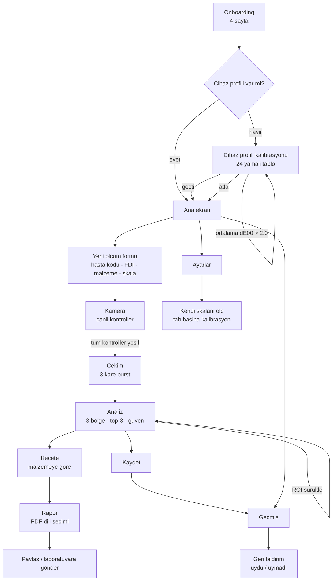

# Nüans / Nuans — Aşama 6: UX/UI ve yerelleştirme

Durum: taslak (Aşama 6 çıktısı)
Önceki aşamalar: [mimari](01-architecture.md) · [algoritma](02-algorithms.md)

---

## 1. Ekran akışı



Akışın iki yerinde **geri dönüşsüz kapı** vardır:

- **Cihaz profili ortalama ΔE00 > 2.0** ise kullanıcı tekrar çekime döner. Atlamak
  mümkündür ama güven skoru sert kapıyla Düşük'e sabitlenir.
- **Canlı kontrollerin hepsi yeşil olmadan çekim butonu pasiftir.** Bu bir uyarı değil,
  bir kilittir: ölçülemeyecek bir kareyi çekip sonra reddetmek, hekimin zamanını iki kez
  harcar.

---

## 2. Kamera ekranı

### 2.1 Neden nötr koyu gri

Ekran, hastanın yüzünün önündeki ikinci en parlak nesnedir. Üzerindeki her renk dişe
yansır ve ölçüme karışır; her geniş parlak alan hekimin kendi kromatik adaptasyonunu
kaydırır — tam da renk yargısında bulunduğu anda. Bu yüzden:

- zemin `#121212` nötr gri, doygunluk sıfır;
- çizgiler açık gri, renk yalnızca kırmızı/yeşil kararın kaçırılamaz olması gereken
  yerde;
- çalışma alanı dışı karartılır (bu aynı zamanda mesafe kılavuzudur: diş silüeti
  doldurmuyorsa "çok uzak" sayı olmadan görünür).

### 2.2 Overlay geometrisi

Her ölçü önizlemenin kesri olarak tutulur. Aynı model üç yeri besler: çizim, dokunma
testi ve native'e giden ROI dikdörtgenleri. Herhangi bir yerde piksel kullanılsa üç kez
dönüştürülmesi gerekir ve eninde sonunda kendisiyle çelişir.

| Öğe | Varsayılan | Not |
|---|---|---|
| Diş silüeti | `0.34, 0.26, 0.32, 0.48` | Merkezde: lens gölgelenmesi kenarlarda en kötü |
| Bant | silüet yüksekliğinin 1/3'ü | Servikal / Gövde / İnsizal, yukarıdan aşağı |
| ROI | bant genişliğinin %50'si × yüksekliğinin %60'ı | Diş eti kenarına ve kesici kenara değmez |
| Gri kart yuvası | genişlik 0.17, yükseklik silüetin %42'si | Sağ/sol değiştirilebilir |
| Skala tabı yuvası | genişlik 0.15 | Kartın karşı tarafında |

ROI'ler sürüklenebilir; sürükleme bant içinde sınırlanır. Yuvalar **kesikli** çizilir ki
ölçülen bir bölgeyle karıştırılmasın.

Kart tarafının değiştirilebilir olması konfor değil: sağ elle ekartör tutan bir hekim
kartı her zaman aynı tarafa koyamaz, zorlanırsa telefonu eğerek çözer — ki bu ölçümün
dayandığı dikliği bozar.

### 2.3 Canlı kontrollerin durum makinesi

Altı kontrol: pozlama, gri kart, netlik, sabitlik, ışık, eğim.

```
            ┌──────────┐  framesToSettle=4 iyi kare   ┌──────────┐
   başla →  │ pending  │ ───────────────────────────► │ passing  │
            └──────────┘                              └──────────┘
                 │                                         │
      1 kötü kare│                                         │ framesToFail=2
                 ▼                                         │ kötü kare
            ┌──────────┐ ◄───────────────────────────────── ┘
            │ failing  │
            └──────────┘
```

**Histerezis cila değil.** 10 Hz'de kare kare değerlendirilen bir kontrol sınırdaki her
değerde titrer ve titreyen bir trafik ışığı hekime onu yoksaymayı öğretir. Yeşile dönüş
yavaş (4 kare), kırmızıya dönüş hızlı (2 kare): yanlış yeşil pahalı olan yöndür.

İki tasarım kararı:

- **Bilinmeyen eğim geçer sayılmaz.** Kullanılabilir hareket sensörü olmayan bir cihaz,
  hiçbir görüntü analiziyle telafi edilemeyecek tek kontrolde bedava yeşil alırdı.
- **Hepsi yeşile döndüğü tek karede hafif haptik verilir** (`becameReady`), her karede
  değil.

### 2.4 Klinik ipuçları

Kamera ekranında dönüşümlü gösterilir, kapatılamaz:

- Ölçümü seansın başında al — dehidrasyon dişi daha açık gösterir.
- Ruj, renkli örtü ve parlak giysiyi kadrajdan uzaklaştır.
- Ekartör kullan — dudak ve dil dişe renk yansıtır.

Bunlar algoritmanın düzeltemediği hatalardır; çözüm prosedüreldir, bu yüzden arayüzde
yaşarlar.

---

## 3. Sonuç ekranı

Sıralama bilinçlidir ve **güven skoru en üstte**, hiçbir renk adından önce gelir. "A3"
okuyup üretime başlayan bir teknisyen, o adın ne kadar değerli olduğunu söyleyen tek
bilgiyi kaybetmiştir.

1. **Güven rozeti** + en zayıf halka ("En zayıf halka: Gri kart") + varsa sert kapı
   gerekçeleri.
2. **Bağıl mod sonucu** varsa: diş ile elindeki tab arasındaki ölçülen fark. Hiçbir
   kütüphaneye, profile veya matrise bağlı değildir — bu yüzden önce gelir.
3. **Diş haritası**: üç bant, her biri renk kodu + eşik rozetiyle (yeşil/sarı/kırmızı).
4. **Bileşen açıklaması**: "Hedef diş, A3 renginden biraz daha açık ve daha az doygun."
5. **İlk 3 alternatif**, ΔE00 ile.
6. **Reçete kartı**, malzemeye göre.
7. **Kütüphane uyarısı**: değerler ölçülmemişse her zaman görünür.
8. **Yasal uyarı**.

ROI'ler bu ekranda da sürüklenebilir; sürükleme yeni çekim yapmaz, `resampleRoi` ile
bellekte tutulan kareden yeniden indirger.

---

## 4. Yerelleştirme

### 4.1 Tek kaynaktan üretim

`lib/l10n/app_tr.arb` ve `app_en.arb` **elle düzenlenmez**;
`tools/l10n/strings.py` içindeki tablodan üretilir. Sebep: elle tutulan iki ARB dosyası
kayar — anahtar birine eklenir, diğerinde unutulur, uygulama ham anahtar gösterir veya
yanlış dile düşer. CI kontrolü bunu olaydan *sonra* yakalar. İki dili yan yana tanımlamak
kaymayı baştan imkânsız kılar ve Türkçe ile İngilizce ifadeyi, yalnızca anahtar değil
*anlam* uyuşmazlığının da görülebileceği yere koyar.

Üretici ayrıca şunları denetler: anahtar adlandırması, her iki dilin varlığı, her mesajın
açıklaması, bildirilen ama kullanılmayan yer tutucu ve **bir dilde olup diğerinde olmayan
yer tutucu** — en güçlü kontrol bu, çünkü o dilde cümlede delik bırakır ve tam olarak
ürüne kaçan hata türüdür.

Bugün: **210 mesaj, iki dil, anahtar kümeleri yapısal olarak özdeş.**

### 4.2 Cümle kurma kuralı

Dart'ta string birleştirerek cümle kurulmaz. ΔL′/ΔC′/ΔH′ açıklaması için:

- yön başına bir ARB anahtarı (`deviationLighter`, `deviationTowardYellow`, …), şiddet
  ICU `select` argümanı olarak içinde — böylece Türkçe ve İngilizce pekiştireci kendi
  dilbilgisinin istediği yere koyar;
- madde sayısı başına bir cümle kalıbı (`comparisonOne`, `comparisonTwo`,
  `comparisonThree`). Parçaları Dart'ta birleştirmek, Türkçe cümlenin İngilizce söz
  dizimiyle çıkmasının yoludur.

Üç madde üst sınırdır, çünkü CIEDE2000'in tam üç bileşeni vardır.

### 4.3 Enum → metin köprüsü

`shade_core` hiç metin üretmez. `lib/core/l10n/clinical_strings.dart` tek köprüdür: 80
ARB anahtarını motorun enum'larına eşler. Tek dosya olması, scorer'a eklenen bir enum
değerinin **derlenmemesi** demektir — ekranda çevrilmemiş görünmesi yerine.

### 4.4 Türkçe büyük/küçük harf tuzağı

Dart'ın `toUpperCase`/`toLowerCase` fonksiyonları yerel ayara duyarsızdır ve Türkçe tam
olarak bunun kırıldığı dildir: `I` → `ı`, `İ` → `i` olmalıyken Dart `I` → `i` ve
`İ` → `i` + birleşen nokta üretir. `IK-14` yazılan bir hasta kodu `ık-14` kayıtlıyla asla
eşleşmez.

Bu yüzden: **hekimin okuduğu metne programatik harf dönüşümü uygulanmaz.** Büyük harf
gereken metin ARB'de zaten büyük harfle yazılır. `TurkishText` yardımcıları yalnızca
eşleştirme ve sıralama için vardır — dönüşüm içseldir, hiç gösterilmez.

### 4.5 Sayı ve tarih: iki ayrı kural

| Yer | Kural | Gerekçe |
|---|---|---|
| Ekran | kullanıcının yereli (`ΔE00 1,2` / `ΔE00 1.2`) | Yanlış ayırıcı okuyan hekim büyüklüğü yanlış okur |
| Veritabanı, dışa aktarma, JSON, log | her zaman nokta ondalık, ISO 8601 UTC | Sayı biçimi kime göre değişen bir dosya geri ayrıştırılamaz; ofsetsiz zaman damgası cihazlar arası karşılaştırılamaz |

ΔE00 **tek ondalıkla** gösterilir: eşikler 0,8 ve 1,8'dir, ikinci ondalık ölçümün sahip
olmadığı bir hassasiyeti ima eder.

---

## 5. PDF raporu

**Dil uygulamadan bağımsız seçilir.** Türkçe arayüz kullanan hekim yurt dışındaki
laboratuvara İngilizce rapor gönderir, bu yüzden rapor üreticisi yerelleştirmelerini
widget ağacından değil, istenen yerel için kendisi çözer (`localizationsFor`).

**Font gömülür.** `pdf` paketinin yerleşik standart fontlarında ç, ğ, ı, İ, ö, ş, ü
glifleri yoktur; onlarla kurulan Türkçe rapor tam klinik terimlerin olduğu yerde delikli
çıkar ve `Ölçüm` kelimesi `lçüm` olur — raporu okuyan hiç kimse bir karakterin
kaybolduğunu değil, hiç yazılmadığını sanır. Noto Sans belgenin içinde yolculuk eder.

İçerik sırası: güven rozeti → ölçüm künyesi → ROI'li görüntü → bölge tablosu (Lab + top-3
+ bileşen cümleleri) → reçete → **kalibrasyon künyesi** → uyarılar.

Kalibrasyon künyesi (cihaz/lens, profil ΔE00 ve tarihi, kütüphanenin klinik kapsama
oranı) raporda bulunmak zorundadır: bir renk adı alan laboratuvarın, o adın kalibre
edilmiş bir cihaz ve ölçülmüş bir skaladan mı yoksa üretici matrisi ve iskeletten mi
geldiğini anlamasının başka yolu yoktur.
